<div align="center">

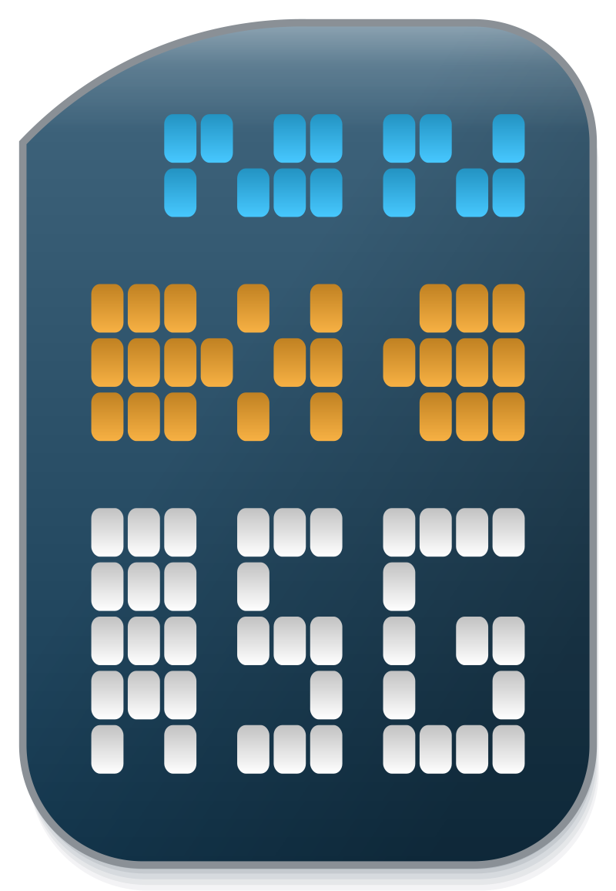

# Messages

**A file & wire schema for sharing numerical data across high-performance computing sessions and programming environments.**

_Managed by XC-Development Team_

</div>

<p align="center">
  
</p>

<p align="center"><em>Figure — XC-Messages carved into a stone stele, recently unearthed: evidence that file & wire schemas outlive their civilizations.</em></p>

## What is Messages?

<p align="center">
  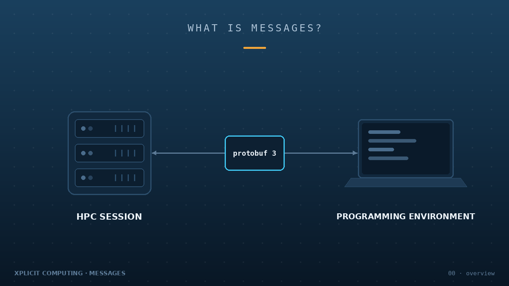
</p>

Messages (libxcmessages) is a file & wire schema designed for engineers and scientists that enables numerical and related data to be shared across high-performance computing sessions and programming environments. It utilizes Google's <a href=https://developers.google.com/protocol-buffers/docs/downloads>Protocol Buffer 3 technology (aka protobuf)</a> to generate universal headers and libraries for encoding and decoding. In Google's words, protobuf is like XML but faster and more efficient. End-users can use the generated language bindings directly in their projects (by linking against compiled libraries or by including the generated implementation files).

Our library consists of ~18 practical concepts for computer-aided engineering. The standard spec includes coalesced data for a particular property, the topologies of discrete geometries, the description of a physical model as its algorithms, the specific setup of a system, and so on. Each message concept is designed to be orthogonal to other message concepts, constructing a practical basis set from a minimum of practical message types. Messages permit embedding sub-message members, which makes complex obect-oriented concepts possible.

This submodule was spun out of the xcompute project in August 2020 and publicly released on 11 July 2022. 

## 0.1. file & wire definitions and utilities

<p align="center">
  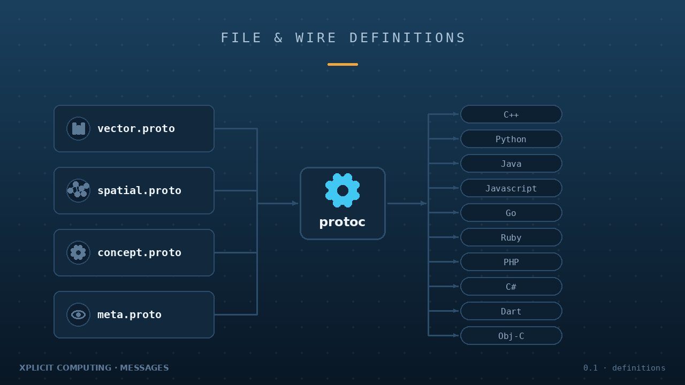
</p>

In order to communicate across a spectrum of programming environments and languages, the layout, names, and types of the known data fields must be defined in a convention that is maintained to promote high-performance interoperability. A protoc compiler uses proto definitions to generate code accessors. These accessor functions are used extensively within CAE projects (such as xcompute-server and xcompute-client) to get and set data and variables across computing sessions.

Messages are distributed in four proto files, used as needed in each context:

- `vector.proto` - packed float and integer arrays (compatible with xco files)
- `spatial.proto` - elements and regions for a geometry (compatible with xcg files) 
- `concept.proto` - domain setup, models, parameters, associations (compatible with xcs files)
- `meta.proto` - meta-data and user-graphics for a specific system (compatible with xcm files)


Google's Protoc 3 compiler generates a linkable library and bindings for the following languages: C++, Objective-C, C#, PHP, Python, Java, Javascript, Ruby, Dart, and Go. Many other 3rd-party language bindings are available (see xcmessages.pdf).

### 0.1.1 data: vector.proto

<p align="center">
  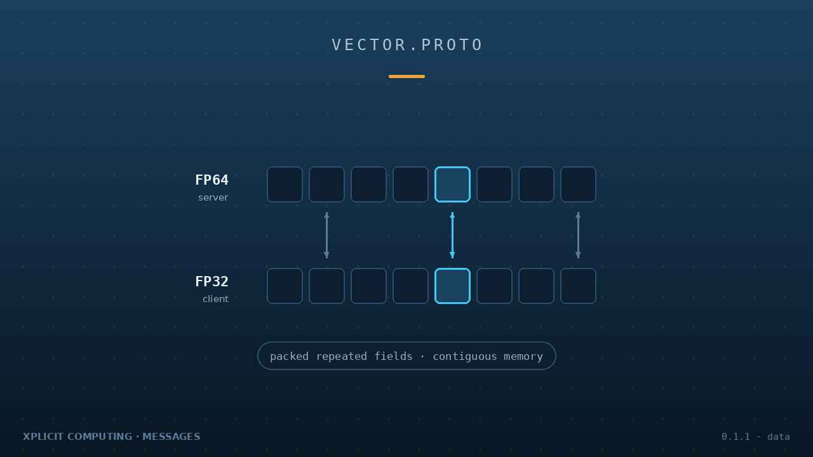
</p>

With `vector.proto`, vectorized data takes advantage of packed repeated fields to permit parallel operations and direct copying, representing the underlying bits according to IEEE-754 in contiguous memory. This information is routinely transmitted across client and server sessions as single and double precision, respectively. In xcmessages.pdf see examples on how to implement `Messages::Vector` zero-copy semantics and parallel iteration.

### 0.1.2 server-side: concept.proto, spatial.proto

<p align="center">
  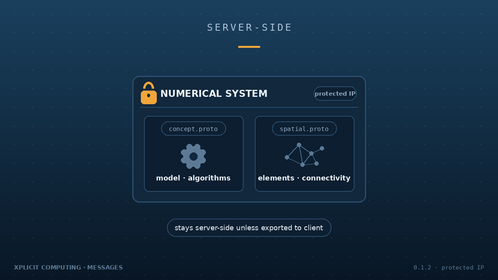
</p>

Numerical domains (aka "systems") are serialized and deserialized according to `concept.proto`, providing object-oriented utilies for saving and transmitting almost any system modeling and processing efforts. Unless exported to client, this information usually stays on server-side as protected IP.

Numerical topologies (aka "geometries") are defined in `spatial.proto`, describing the element connectivity between nodes using indicies. Unless exported to client, this information usually stays on server-side as protected IP.

### 0.1.3 client-side: meta.proto

<p align="center">
  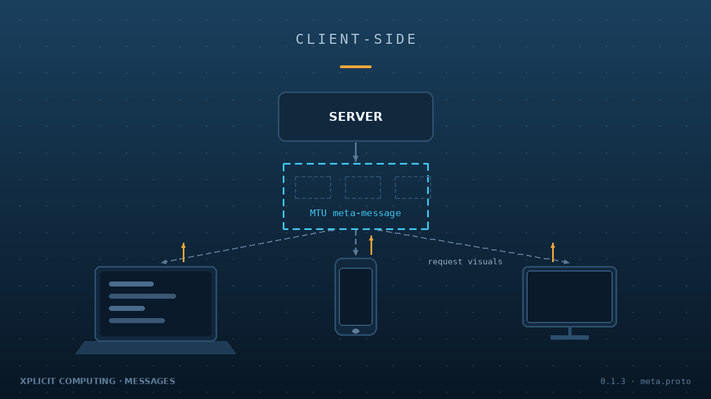
</p>

Once a numerical system is set up, user-facing data is staged on the server (under system.visuals) for transmission. The file `meta.proto` defines a single MTU skeletal "meta-message" is broadcast to all connected hosts, whereby the recepients are responsible for looking into this skelton and requesting any needed visuals data in subsequent calls. It is possible to utilize the definitions in `meta.proto` to save/load the user-specific graphics state as a sort of opaque media format (for offline review, controlled sharing, etc). Because of these characteristic attributes, saved client-side meta content can be considered an optional "meta-media-profile".

## 1. getting started

<p align="center">
  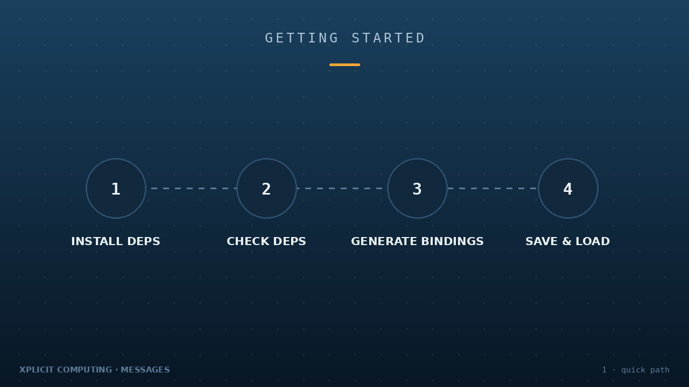
</p>

Protobufs might be a little odd or difficult at first, but once one becomes accustomed to their usage, they are quite straight-forward to implement. There is no magic -- just a code generator that builds headers/code to be called and compiled into your software project.

### 1.1. installing dependencies

<p align="center">
  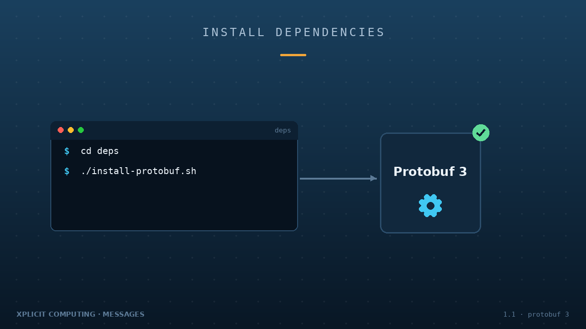
</p>

Download and install Google Protobuf 3 with the script:
```
cd deps
./install-protobuf.sh
```

For special installation, see: https://github.com/protocolbuffers/protobuf/blob/master/src/README.md
. If compiling manually, run `./autogen.sh`  and set the prefix path to `/usr/local` or desired location: 
```
./configure --prefix=/usr/local
```
Then follow with the standard: `make`, `make check`, `sudo make install`, `sudo ldconfig`

### 1.2. checking dependencies

<p align="center">
  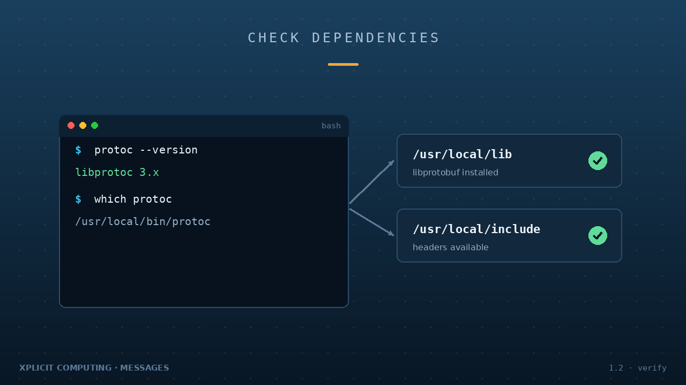
</p>

Protobuf3 should have been installed in the previous step. Assure protocol buffer compiler has installed and is version 3+:
```
protoc --version
```
And check its path:
```
which protoc
```
There should be a corresponding set of `libprotobuf` in `/usr/local/lib/` and headers in `/usr/local/include/` , or wherever you specified as the installation prefix.

### 1.3. generating bindings

<p align="center">
  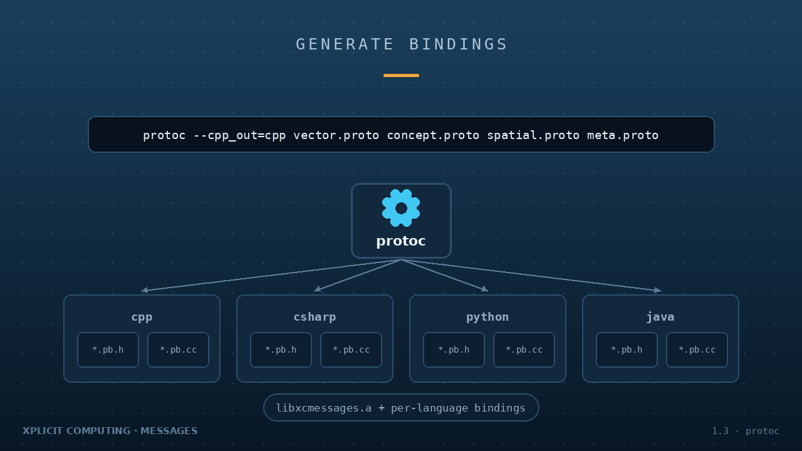
</p>

Invoke the protoc compiler for the desired output language (including the name of the output folder following equals sign) against proto files to yield libxcmessages.a and bindings. For example, to generate only c++ accessors for vector.proto:

```
protoc --cpp_out=cpp vector.proto
```
Header and source files with `*.pb.h` and `*.pb.cc` extensions are generated (to be included in your larger project).

Multiple languages and proto files can be compiled at once, like so:

```
protoc --cpp_out=cpp --csharp_out=csharp –objc_out=objc --ruby_out=ruby --python_out=python --java_out=java --js_out=javascript vector.proto concept.proto spatial.proto meta.proto
```

### 1.4. basic save & load

<p align="center">
  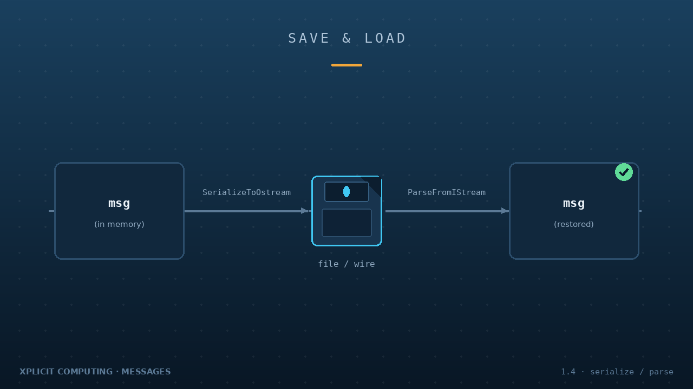
</p>

In order to save or transmit, a program’s associative data structures must be serialized into a format that permits representation in contiguous memory and/or storage. Several built-in serialization functions are available including those that leverage a std output file stream. For instance, one could write to filesystem a file containing `Messages::Vector64`, using C++ :

```#include "vector.pb.h" ```

```
std::ofstream outfile(path); // create an output file stream with given path
msg.SerializeToOstream(&outfile); // serialize a prepared Messages::Vector64
outfile.close(); // finish the file and release resource
```
Serialized data can then be transmitted over file-and-wire to another computer session, where it is then de-serialized (parsed) using the paired load function such as std:: input file stream:
```
std::ifstream infile(path); // create an input file stream
Messages::Vector64 msg; // create an empty message container
msg.ParseFromIStream(&infile); // de-serialize binary file to fill message
infile.close(); // finish the file and release resource
```
## 2. Learn More

<p align="center">
  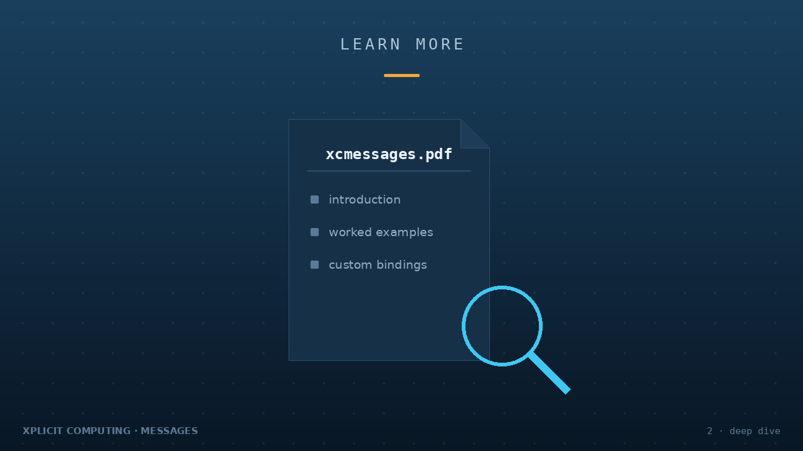
</p>

Please see `xcmessages.pdf` for thorough introduction and examples.

## 3. license and fair use

<p align="center">
  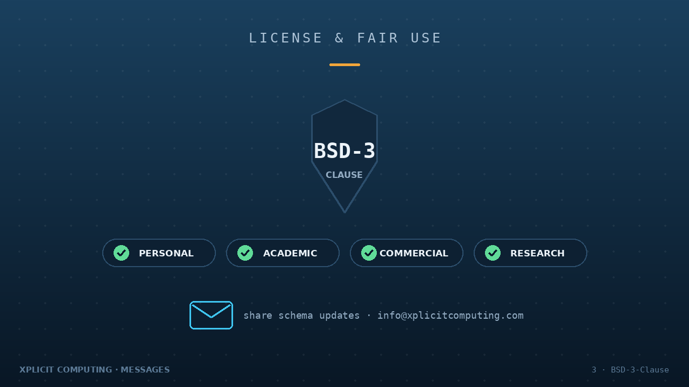
</p>

- SPDX-License-Identifier: BSD-3-Clause
- OSI-License-URL: https://opensource.org/licenses/BSD-3-Clause

These four proto files, the generated library/bindings, and this README file are provided under the BSD 3-Clause License.
You are free to use these components for personal, academic, commercial, and/or research use.  No warranty is implied nor provided unless otherwise stated in a separate engineering support agreement.  As part of the license agreement, this README file must remain alongside any provided *.proto definitions.

A copy of the BSD 3-Clause License resides in the LICENSE file of this software. It can also be found online at OSI-License-URL.

Custom extensions to the schema are permitted for private use.  (See "Building custom bindings" in `xcmessages.pdf`.)
However, to foster schema consistency across the Messages user community, please share proposed public schema and documentation updates with the maintainers at info@xplicitcomputing.com.

